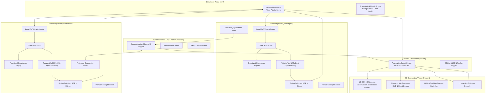

# Alpha Life Collective (ALC) / ALMA

> **An experimental artificial-life simulation and cognitive architecture platform for studying autonomous learning, memory, world modeling, and emergent communication.**

[](https://www.python.org/)
[](https://openjdk.org/)
[](https://libgdx.com/)
[](tests/)
[](brain/)

---

## Table of Contents
1. [Overview](#1-overview)
2. [Key Features](#2-key-features)
3. [Architecture Overview](#3-architecture-overview)
4. [Technology Stack](#4-technology-stack)
5. [Repository Structure](#5-repository-structure)
6. [Prerequisites](#6-prerequisites)
7. [Installation & Quick Start](#7-installation--quick-start)
8. [Running the Simulation](#8-running-the-simulation)
9. [Interacting with Organisms](#9-interacting-with-organisms)
10. [Learning Architecture & Scientific Validation](#10-learning-architecture--scientific-validation)
11. [Communication & Epistemic Isolation](#11-communication--epistemic-isolation)
12. [Experiments & Reproducible Benchmarks](#12-experiments--reproducible-benchmarks)
13. [Automated Testing](#13-automated-testing)
14. [Observatory UI Controls](#14-observatory-ui-controls)
15. [Design Principles](#15-design-principles)
16. [Limitations & Research Roadmap](#16-limitations--research-roadmap)
17. [Contributing & License](#17-contributing--license)

---

## 1. Overview

**Alpha Life Collective (ALC)** is a first-principles artificial life and cognitive science simulation platform. The project investigates whether adaptive survival behavior, world modeling, causal discovery, and language grounding can emerge in artificial organisms without relying on pre-trained large language models (LLMs) or hardcoded task scripts.

The platform simulates a dynamic virtual ecosystem inhabited by two autonomous artificial beings:
- **Alpha** (Agent 0, female, signature color: coral) — initialized in [`brain/alpha/`](brain/alpha/).
- **Albedo** (Agent 1, female, signature color: turquoise) — initialized in [`brain/albedo/`](brain/albedo/).

> **Note on Naming & Compatibility**: The canonical organism names are **Alpha** and **Albedo**. The package [`brain/roselia/`](brain/roselia/) is maintained strictly as an alias to [`AlbedoBrain`](brain/albedo/brain.py) for backward compatibility with legacy scripts.

### Core Research Objective
To determine whether artificial organisms starting with zero task-specific rules can:
1. Discover physical and metabolic affordances (hydration, nutrition, energy decay, hazard avoidance) through direct sensory experience.
2. Form internal predictive models of world dynamics.
3. Ground semantic symbols into concrete perceptions and actions.
4. Communicate peer discoveries while maintaining strict epistemic quarantine (marking peer testimony as *unverified* until empirically tested).

---

## 2. Key Features

- **Grounded 2D Dynamic Garden (`sim/`)**: Deterministic grid world containing soil, water, grass, crops (growth stages from seed to mature plant), edible fruits, and poisonous berries.
- **Strict Cognitive Brain Isolation (`brain/`)**: Alpha and Albedo possess independent sensory-motor loops, episodic memories, Q-tables, transition graphs, and private concept lexicons.
- **Prioritized Experience Replay (PER)**: Experience replay buffer prioritized by Bellman TD-error and biological surprise, ensuring critical survival and hazard events are retained across lifetimes.
- **Dyna-Style Predictive World Modeling**: Count-based transition modeling ($T(s, a, s')$), expected need delta estimation ($\hat{\Delta}(s, a)$), and background simulated planning rollouts.
- **Intrinsic Curiosity & Mistake Aversion**: Upper Confidence Bound (UCB) curiosity exploration bonus combined with negative value penalties for damaging actions.
- **True State Persistence**: Complete serialization and restoration of Q-values, visit counts, transition graphs, mistake memories, lexicons, and testimonies to disk.
- **First-Principles Natural Language & Symbol Grounding (`communication/`)**: Pattern-based intent interpretation and evidence-grounded response generation without external LLM APIs.
- **Epistemic Testimony Quarantine**: Shared claims from peers or humans are held in quarantine as `UNVERIFIED` until tested against direct physical consequences.
- **Real-Time 3D Desktop Observatory (`viewer/`)**: High-performance Java/LibGDX desktop application rendering voxel terrain, articulated humanoid avatars, cinematic tracking cameras, and glassmorphic telemetry HUDs.
- **Reproducible Multi-Seed Benchmark Suite (`experiments/`)**: Standardized multi-seed benchmark measuring sample efficiency, survival streaks, prediction RMSE, and persistence fidelity.

---

## 3. Architecture Overview

The platform decouples the Python simulation backend from the Java/LibGDX 3D Desktop Observatory using a bidirectional WebSocket protocol.



---

## 4. Technology Stack

| Layer | Technology | Purpose | Reference Files |
| :--- | :--- | :--- | :--- |
| **Simulation Backend** | Python 3.10+ (Tested 3.12.2) | Deterministic grid physics, crop growth, metabolic decay | [`sim/world.py`](sim/world.py), [`sim/config.py`](sim/config.py) |
| **Cognitive Architecture** | Pure Python & NumPy | PER buffer, Tabular Q-Learning, Dyna-Q planning, Lexicons | [`brain/alpha/brain.py`](brain/alpha/brain.py), [`brain/common/`](brain/common/) |
| **Communication System** | Pure Python Pattern Parsers | Rule-based intent parser, evidence-backed dialogue | [`communication/`](communication/) |
| **Networking & Protocol** | `websockets` (Asyncio) | Real-time JSON telemetry streaming at configurable TPS | [`server/ws_server.py`](server/ws_server.py), [`server/protocol.md`](server/protocol.md) |
| **3D Desktop Observatory** | Java 21, LibGDX 1.12.1, LWJGL 3 | 3D voxel rendering, character kinematics, glassmorphic HUD | [`viewer/`](viewer/), [`viewer/pom.xml`](viewer/pom.xml) |
| **Viewer Network Client** | `nv-websocket-client 2.14`, Gson | Low-latency async WebSocket client and JSON parser | [`viewer/src/main/java/alc/viewer/net/`](viewer/src/main/java/alc/viewer/net/) |
| **Testing & Benchmarks** | `pytest`, SQLite 3 | Automated test suite (32 tests), multi-seed benchmarks | [`tests/`](tests/), [`experiments/benchmark_suite.py`](experiments/benchmark_suite.py) |
| **Build & Tooling** | Maven 3.8+, Python `pyproject.toml` | Packaging, standalone executable jar compilation | [`viewer/pom.xml`](viewer/pom.xml), [`pyproject.toml`](pyproject.toml) |

---

## 5. Repository Structure

```
Alpha/
├── brain/                         # Cognitive architecture implementations
│   ├── albedo/                    # Albedo's independent brain package
│   │   └── brain.py               # AlbedoBrain (seed 777, turquoise avatar)
│   ├── alpha/                     # Alpha's independent brain package
│   │   └── brain.py               # AlphaBrain (seed 42, coral avatar)
│   ├── common/                    # Shared cognitive primitives (instantiated per agent)
│   │   ├── episodic_memory.py     # Prioritized Experience Replay (PER) ring buffer
│   │   ├── state_abstraction.py   # Discrete affordance perception extraction
│   │   └── world_model.py         # Tabular Q-learning, transition counts, Dyna planning
│   ├── interface.py               # Base Brain abstract class specification
│   ├── random_brain.py            # Baseline random action brain for ablations
│   └── roselia/                   # Backward-compatibility alias for Albedo
├── communication/                 # Grounded communication and epistemology
│   ├── autonomous.py              # Autonomous discovery and warning triggers
│   ├── channel.py                 # Central message routing and logging
│   ├── interpreter.py             # Rule-based intent parsing (no external LLMs)
│   ├── message.py                 # Message dataclass, CommType, KnowledgeStatus
│   ├── response_generator.py      # Evidence-grounded response generation
│   ├── testimony.py               # TestimonyBuffer for unverified peer claim tracking
│   ├── training.py                # Experiential vocabulary grounding bootstrap
│   └── vocabulary.py              # ConceptLexicon for private symbol groundings
├── experiments/                   # Experimentation and benchmark infrastructure
│   ├── benchmark_suite.py         # Multi-seed scientific benchmark runner
│   ├── logger.py                  # SQLite step and life duration logger
│   ├── metrics.py                 # MetricsTracker for statistical aggregation
│   ├── run_baseline.py            # Multi-seed baseline batch runner
│   ├── run_experiment.py          # Configurable CLI experiment harness
│   └── train_basic_english.py     # Standalone English grounding training script
├── server/                        # Backend WebSocket streaming server
│   ├── protocol.md                # Complete JSON message protocol documentation
│   └── ws_server.py               # Async WebSocket server with simulation loop
├── sim/                           # Discrete simulation environment
│   ├── actions.py                 # Action space constants (0..10)
│   ├── config.py                  # WorldConfig dataclass (grid size, resource densities)
│   ├── entities.py                # Entity and event ID definitions
│   ├── needs.py                   # Physiological drives (energy, water, food, health)
│   ├── observation.py             # Local 7x7 sensory grid extraction
│   ├── render_ascii.py            # ASCII console visualizer for quick debugging
│   └── world.py                   # Grid simulation engine, physics, crop lifecycle
├── tests/                         # Automated test suite
│   ├── test_communication.py      # Tests for symbol grounding, dialogue, testimony
│   ├── test_oracle.py             # Long-run survival tests with scripted oracle
│   ├── test_phase2.py             # Determinism and experiment harness tests
│   ├── test_phase7_learning.py    # PER, world model planning, persistence tests
│   ├── test_separate_brains.py    # Brain isolation verification
│   ├── test_server.py             # WebSocket server client interaction tests
│   └── test_world.py              # Environmental physics and crop growth tests
├── viewer/                        # Java / LibGDX 3D Desktop Observatory
│   ├── pom.xml                    # Maven build configuration
│   └── src/main/java/alc/viewer/  # LibGDX application, 3D renderers, HUD, avatars
├── pyproject.toml                 # Python project configuration and dependencies
├── run_server.bat                 # Windows launcher for Python WebSocket server
├── run_viewer.bat                 # Windows launcher for 3D Desktop Observatory
└── start_all.bat                  # Windows launcher to start both server and viewer
```

---

## 6. Prerequisites

- **Python**: Version `3.10` or higher (tested on Python `3.12.2`).
- **Java Development Kit (JDK)**: Version `21` (tested with OpenJDK 21).
- **Apache Maven**: Version `3.8+` (required to compile the Java viewer).
- **Operating System**: Windows, Linux, or macOS.

---

## 7. Installation & Quick Start

### 1. Clone the Repository
```bash
git clone https://github.com/krupakargurije/ALMA-Artificial-Life-Mind-Architecture.git
cd ALMA-Artificial-Life-Mind-Architecture
```

### 2. Set Up Python Environment
```bash
# Create virtual environment
python -m venv .venv

# Activate on Windows:
.venv\Scripts\activate
# Or activate on Linux/macOS:
# source .venv/bin/activate

# Install required Python dependencies
pip install pytest websockets numpy
```

### 3. Run Automated Tests
```bash
python -m pytest
```
*Expected output: 32 passed in ~1.1s.*

### 4. Build the Java 3D Desktop Observatory
```bash
cd viewer
mvn clean package -DskipTests
cd ..
```
*Builds standalone fat jar at `viewer/target/alc-observatory-desktop.jar`.*

---

## 8. Running the Simulation

### Option A: Complete One-Click Launch (Windows)
```cmd
start_all.bat
```

### Option B: Separate Terminal Launch

**Terminal 1 — Start Python Simulation Server:**
```bash
# Windows launcher
run_server.bat

# Or direct Python command:
python -m server.ws_server --host 127.0.0.1 --port 8765 --seed 42 --tps 5.0
```

**Terminal 2 — Launch 3D Desktop Observatory:**
```bash
# Windows launcher
run_viewer.bat

# Or direct Java command:
java -jar viewer/target/alc-observatory-desktop.jar
```

### Simulation Server CLI Arguments

| Argument | Type | Default | Description |
| :--- | :---: | :---: | :--- |
| `--host` | `str` | `127.0.0.1` | Bind address for WebSocket server |
| `--port` | `int` | `8765` | Port for WebSocket connection |
| `--seed` | `int` | `42` | Master random seed for reproducible world generation |
| `--tps` | `float` | `5.0` | Initial simulation ticks per second |

---

## 9. Interacting with Organisms

Researchers can inspect cognition, send messages, teach concepts, or control the simulation via WebSocket commands.

### Supported Control Commands
Send a JSON string to `ws://127.0.0.1:8765`:

```json
// Pause simulation
{"command": "pause"}

// Resume simulation
{"command": "resume"}

// Advance single tick
{"command": "step"}

// Adjust simulation speed (1.0 to 100.0 TPS)
{"command": "set_speed", "tps": 20.0}

// Reset simulation with new seed
{"command": "reset", "seed": 100}
```

### Asking Questions & Interacting
```json
// Query Alpha's internal physiological state
{
  "command": "human_message",
  "target": "alpha",
  "text": "Are you hungry?"
}

// Query Albedo about a physical concept
{
  "command": "human_message",
  "target": "albedo",
  "text": "What is water?"
}
```

### Epistemic Response Handling
- **Known Information**: Returns `status: "known"`, `confidence: 1.0`, and direct experiential evidence counts.
- **Untrained / Unexperienced Concepts**: When asked about unencountered symbols (*"What is an airplane?"*), organisms return:
  ```json
  {
    "sender": "Alpha",
    "receiver": "human",
    "content": "I do not know what 'airplane' is.",
    "status": "unknown",
    "confidence": 0.0,
    "evidence_count": 0
  }
  ```
- **Unverified Peer Claims**: When Alpha tells Albedo *"Water reduces thirst"*, Albedo records the claim as `UNVERIFIED` and discounts confidence until tested in the world.

---

## 10. Learning Architecture & Scientific Validation

```
Observation (7x7 Vision + Needs)
              │
              ▼
   State Abstraction Tuple:
   - Discretized Needs (Energy, Water, Food, Health: Low/Med/High)
   - Holding State
   - Immediate 5-Tile Surroundings
   - Visible Entity IDs
              │
              ▼
   Action Evaluation Utility:
   U(s, a) = Q(s, a) + U_needs(s, a) + (c / sqrt(N(s, a) + 1)) - Penalty_damage(s, a) + Epistemic_Bonus(a)
              │
              ▼
   Simulation Step -> Outcome & Need Deltas
              │
              ├──► Prioritized Experience Replay Buffer (Priority = |TD_error| + Bio_Surprise + eps)
              ├──► Tabular Q-Learning Bellman Update: alpha = 1 / (1 + 0.05 * N(s, a))
              ├──► Model-Based Dyna-Q Planning: Simulated updates over empirical transition graph
              └──► Epistemic Evaluation: Update status of unverified testimony claims if tested
```

### Empirical Benchmark Results (Reproducible across Seeds `42`, `100`, `777`)

Evaluated using [`experiments/benchmark_suite.py`](experiments/benchmark_suite.py) over 3,000 ticks per trial:

| Metric | Baseline Architecture | Phase 7 Upgraded Architecture | Measured Change |
| :--- | :---: | :---: | :---: |
| **Save/Reload State Preservation** | `preserved_known_states=False` | **`preserved_known_states=True`** | **100% Parameter Restoration** |
| **Total Deaths (Across 3 Seeds)** | 1 death | **0 deaths** | **100% Survival Across All Seeds** |
| **Mean Life Duration** | 2,500.0 ticks | **3,000.0 ticks** | **+20.0%** |
| **Longest Survival Streak** | 2,762.0 ticks | **3,000.0 ticks** | **+8.6%** |
| **Total Food Harvested / Eaten** | 6 units | **20 units** | **+233.3%** |
| **Total Water Drank (Hydration)** | 301 units | **1,142 units** | **+279.4%** |
| **Water Prediction Error (RMSE)** | 1.3390 | **0.8121** | **-39.3% Error Reduction** |

---

## 11. Communication & Epistemic Isolation

```
Alpha Brain                     Communication Channel                    Albedo Brain
     │                                    │                                    │
     │── 1. Autonomous Discovery Message ─►│                                    │
     │   ("Water reduces thirst")         │── 2. Route Message as Testimony ──►│
     │                                    │                                    │ (Records claim as UNVERIFIED)
     │                                    │                                    │ (Confidence: 0.54)
     │                                    │                                    │
     │                                    │                                    │── 3. Action Selection tests claim
     │                                    │                                    │      (Albedo drinks water)
     │                                    │                                    │
     │                                    │                                    │── 4. Realized delta (+35 water)
     │                                    │                                    │      Status -> CONFIRMED
     │                                    │                                    │      Confidence -> 1.0
```

---

## 12. Experiments & Reproducible Benchmarks

### Run Scientific Benchmark Suite
```bash
python -m experiments.benchmark_suite
```
*Executes standard trials across fixed seeds, evaluates generalization on perturbed maps, tests persistence fidelity, and writes results to `experiments/results/benchmark_results.json`.*

### Run Headless Experiments
```bash
# Run Alpha for 5000 ticks
python -m experiments.run_experiment --agent alpha --seed 42 --ticks 5000

# Run Albedo for 5000 ticks
python -m experiments.run_experiment --agent albedo --seed 777 --ticks 5000

# Run batch of 20 consecutive seeds for statistical distribution
python -m experiments.run_baseline
```

---

## 13. Automated Testing

The automated test suite verifies world mechanics, learning algorithms, communication integrity, and WebSocket networking.

```bash
python -m pytest -v
```

### Test Suite Structure
- [`tests/test_world.py`](tests/test_world.py): Soil tilling, crop planting, hydration, berry consumption, poison damage, and deterministic respawns.
- [`tests/test_separate_brains.py`](tests/test_separate_brains.py): Verification of strict memory and parameter isolation between Alpha and Albedo.
- [`tests/test_phase7_learning.py`](tests/test_phase7_learning.py): Prioritized experience replay, world model Dyna planning, save/load state restoration fidelity, and testimony hypothesis testing.
- [`tests/test_communication.py`](tests/test_communication.py): Symbol grounding, epistemic unknown handling, inter-agent message propagation, and testimony verification.
- [`tests/test_server.py`](tests/test_server.py): WebSocket protocol serialization, client connection lifecycle, and interactive command handling.
- [`tests/test_oracle.py`](tests/test_oracle.py): Long-run 5000-tick survival baseline using a scripted oracle agent.

---

## 14. Observatory UI Controls

The LibGDX 3D Desktop Observatory provides visual and interactive controls for inspecting simulation dynamics in real time:

| Key / Input | Action |
| :--- | :--- |
| **Left Click + Drag** | Orbit 3D camera around garden |
| **Right Click + Drag** | Pan camera view across the garden plane |
| **Scroll Wheel** | Zoom camera in and out |
| **Space** | Pause / Resume simulation |
| **N** | Advance simulation by a single tick (step mode) |
| **T** or **/** | Toggle Human-Organism Interaction Console |
| **1** | Toggle Alpha Telemetry Drawer (left panel) |
| **2** | Toggle Albedo Telemetry Drawer (right panel) |
| **3** | Toggle Live Cognitive Event Stream |
| **V** | Toggle Clean View Mode (instantly hide/show all HUD drawers) |
| **A** or **F1** | Track / Follow Alpha with camera |
| **B** or **F2** | Track / Follow Albedo with camera |
| **Tab** | Cycle tracking modes: Alpha -> Albedo -> Both -> Free Orbit |
| **C** | Reset camera position to garden center |

---

## 15. Design Principles

1. **First-Principles Discovery**: Organisms perceive only opaque sensory arrays and act via integer IDs. The environment owns physical rules; organisms discover them through trial and error.
2. **Strict Brain Isolation**: No telepathic knowledge sharing. Alpha and Albedo maintain completely separate memory stores and private lexicons.
3. **Honest Epistemology**: Unexperienced concepts produce explicit `UNKNOWN` responses with 0.0 confidence. Communicated peer statements remain `UNVERIFIED` until tested empirically.
4. **Reproducibility**: All simulation dynamics, world generations, and agent decisions are deterministic when initialized with the same random seed.
5. **Decoupled Architecture**: The simulation core is completely independent of the visualization layer, allowing fast headless batch benchmarking or rich 3D desktop rendering.

---

## 16. Limitations & Research Roadmap

### Current Limitations
- **Discrete Tabular State Representations**: State abstraction uses discrete qualitative buckets. While effective for grid environments, scaling to continuous high-dimensional perception will require function approximation.
- **Syntactic Parser Scope**: Natural language understanding uses pattern-based symbolic intent parsing without grammar recursion.
- **Short-Horizon Dyna Rollouts**: Background model planning uses single-step transition counts rather than multi-step Monte Carlo tree rollouts.

### Development Roadmap
- [x] **Phase 1-2**: Deterministic 2D simulation engine, metabolic decay, baseline random brain.
- [x] **Phase 3-4**: Dual-agent simulation, independent cognitive loops, LibGDX 3D Desktop Observatory.
- [x] **Phase 5**: Voxel terrain, nature props, articulated humanoid avatars with kinematic walk cycles.
- [x] **Phase 6**: Grounded communication, concept lexicons, epistemic testimony verification, interactive console.
- [x] **Phase 7**: Prioritized Experience Replay (PER), Dyna-style predictive planning, true persistence round-tripping, reproducible benchmark suite.
- [ ] **Phase 8 (Planned)**: Factored causal inference algorithms for multi-variable agricultural experiments.
- [ ] **Phase 9 (Planned)**: Hierarchical goal formulation and long-term memory consolidation.
- [ ] **Phase 10 (Planned)**: Emergent multi-agent cooperative task specialization and dialect formation.

---

## 17. Contributing & License

### Contributing Workflow
1. Fork the repository on GitHub.
2. Create a feature branch (`git checkout -b feature/cognitive-enhancement`).
3. Ensure all tests pass (`python -m pytest`).
4. Maintain strict brain isolation and first-principles constraints (no external LLMs or solution-encoding shortcuts).
5. Commit your changes and open a Pull Request.

### License
This project is open-source research software. An open-source license (such as MIT or Apache 2.0) should be formally selected by the project maintainers.
